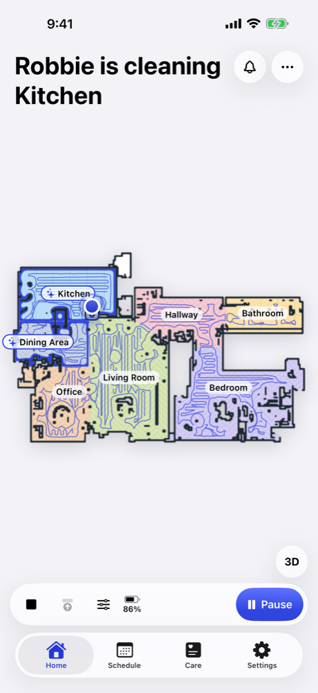
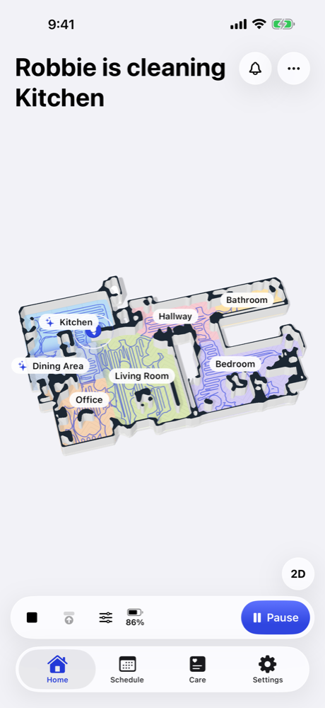
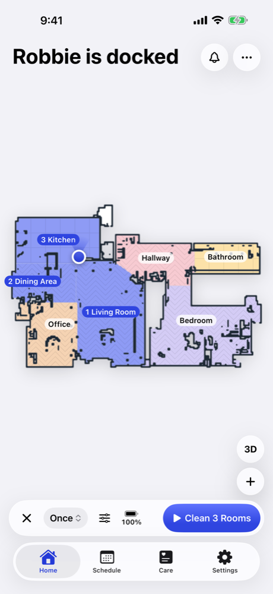
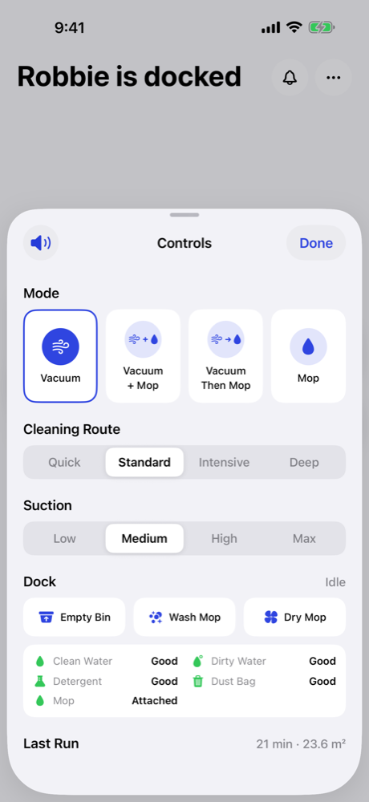
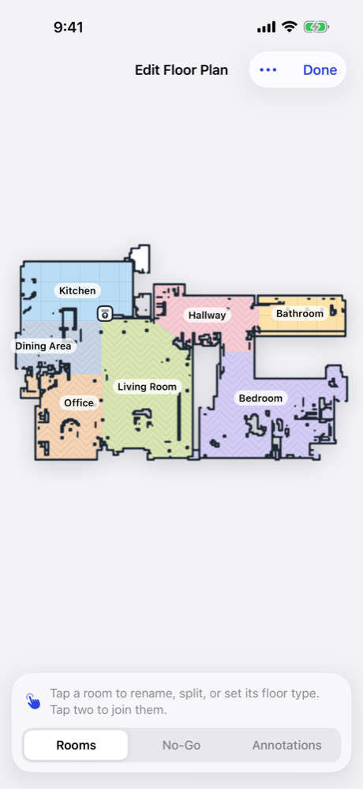
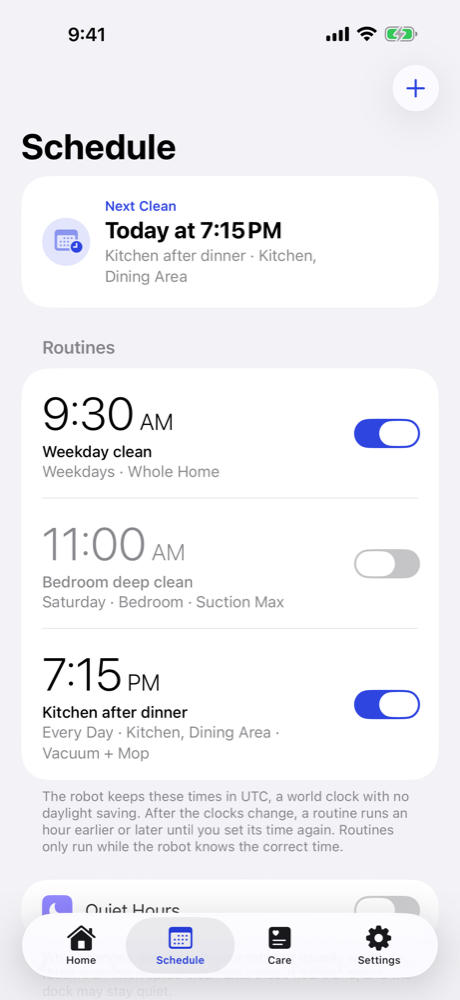
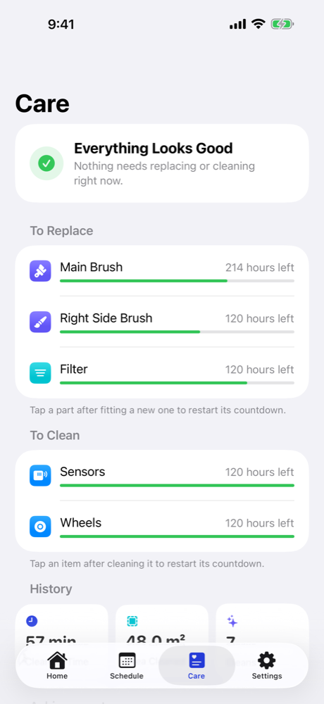

# OpenVacuum

[](https://github.com/bsidio/OpenVaccum/actions/workflows/ci.yml)

A native iPhone app for robot vacuums running [Valetudo](https://valetudo.cloud). It talks directly to your robot over your home network, with no cloud service, account or tracking.

This is an unofficial app. It isn't affiliated with or endorsed by the Valetudo project.

<p align="center">
  
  
  
  
</p>
<p align="center">
  
  
  
</p>

The screenshots use Valetudo's public sample map.

## What it does

- **Set up a new robot:** join a robot that isn't on Wi-Fi yet to your network, as Valetudo's own setup page does.
- **Live floor plan:** see the robot move, with pinch to zoom, or switch to a 3D model of your home that you can turn and tilt.
- **Cleaning route:** choose Quick, Standard, Intensive or Deep in Controls, next to the mode, on robots that offer it.
- **Clean anywhere:** tap rooms in the order you want, touch and hold for a pin, or stretch a zone, then start from the bar. Everything also works from the + button and with VoiceOver.
- **Connect other apps:** touch and hold the start button to see the exact request a job sends, ready to copy into Home Assistant or anything else that speaks MQTT or REST.
- **Edit the floor plan:** rename, split and join rooms, set floor types, and add walls, no-go zones, no-mop zones and annotations.
- **Mapping:** run a mapping pass, accept a new plan, restore backups, or start again.
- **Drive by hand:** use a joystick or D-pad on any robot, or a hardware keyboard if one is attached.
- **Camera:** watch the live feed above the floor plan or full screen, or while driving, with what the camera can see marked on the plan, and optional on-device image recognition from Apple's Vision framework.
- **Obstacle photos:** tap an obstacle to see what the robot saw. If the robot couldn't name it, Vision looks at the photo on your phone to give it the right icon.
- **Schedule:** set routines and quiet hours.
- **Care:** track parts, cleaning reminders and history.
- **Dock and alerts:** empty the bin, wash and dry the mop, and go back through the robot's past alerts.
- **Several robots:** save more than one, switch between them from Home or Settings, and star favorites to keep them at the top.
- **Settings:** dock behavior, voice packs, Wi-Fi, MQTT, time, login, updates, logs and system information.

The app usually finds your robot on its own. If it doesn't, enter its address. The app reads what each robot supports and only shows those controls, so one build works across Valetudo's supported robots.

## Requirements

- iOS 17 or later
- A robot running Valetudo. Features depend on your robot and Valetudo version.

## Build it

You need a Mac with Xcode 26 or later. The app uses the iOS 26 SDK for Liquid Glass, but still runs on iOS 17.

```sh
git clone https://github.com/bsidio/valetudo-ios.git
cd valetudo-ios
open OpenVacuum.xcodeproj
```

Choose a simulator and press Run.

To install on your iPhone, select the OpenVacuum target and open **Signing & Capabilities**. Choose your team, then change **Bundle Identifier** to something of your own, such as `com.yourname.openvacuum`, because Apple lets only one team use each identifier. A free Apple ID works, but the app then expires after 7 days.

The first time you run it on the iPhone, turn on **Developer Mode** under **Settings > Privacy & Security**. With a free Apple ID, you also need to trust your certificate under **Settings > General > VPN & Device Management** before the app will open.

The project is generated from `project.yml`. If you change it, run `xcodegen`, which you can install with `brew install xcodegen`. That resets your team and bundle identifier, so you'll need to set them again.

## Tests

```sh
xcodebuild test -project OpenVacuum.xcodeproj -scheme OpenVacuum \
  -destination "platform=iOS Simulator,name=iPhone 17 Pro"
```

If you don't have that simulator, use any iPhone from `xcrun simctl list devices available`.

## Camera

The app can show your robot's camera, but it can't turn the camera on. To set it up:

1. Turn on **Camera Streaming** in Valetudo's web interface, under **Options > Valetudo**, and read what it says first.
2. Install the [Duststreamer](https://github.com/Hypfer/Duststreamer) on the robot yourself.

This is deliberate. Valetudo keeps camera setup manual so that a vacuum can't become a hidden camera with one tap, and this app respects that. Please don't send pull requests that automate it. People near the robot can't tell when it's streaming, so make sure everyone in your home knows and agrees.

While streaming is off, the app doesn't mention the camera at all. You can turn it off from the app at any time, which also deletes the Duststreamer from the robot.

Valetudo streams MPEG-1 video inside MPEG-TS, which iOS can't play, so the app unpacks the stream itself and decodes it with [pl_mpeg](https://github.com/phoboslab/pl_mpeg). The video is never recorded or saved.

## Privacy and security

See the [privacy policy](PRIVACY.md) and [support page](SUPPORT.md).

The app talks only to your robot, and nothing is sent anywhere else. Your password stays in the iOS Keychain, and obstacle photos aren't kept on the phone.

Valetudo doesn't offer HTTPS, so logins and Wi-Fi passwords cross your home network unencrypted. Use a password you don't use anywhere else.

## Support

This app isn't part of the Valetudo project, so please report problems with it in [this repository's issues](https://github.com/bsidio/valetudo-ios/issues), not to Valetudo.

## Not included

- iPad layouts. The app runs on iPhone.

## License

OpenVacuum is open source under the [MIT License](LICENSE). Parts that come from other projects keep their own licenses, listed under Credits.

## Credits

Built on [Valetudo](https://github.com/Hypfer/Valetudo) by Sören Beye. Achievement names and descriptions come from Valetudo, Copyright 2018 Sören Beye, under the Apache License 2.0. A copy of that license is in `Valetudo/Valetudo-License.txt` and in the app. Video decoding uses [pl_mpeg](https://github.com/phoboslab/pl_mpeg) by Dominic Szablewski, under the MIT license below. The same notice is in the app, under **Settings > About**.

`Valetudo/Vendor/pl_mpeg.h` is that library's header, unmodified, from commit `c871f2be02`. That version only names the license, so the notice below comes from its earlier headers.

```text
Copyright (c) 2019 Dominic Szablewski

Permission is hereby granted, free of charge, to any person obtaining a copy of
this software and associated documentation files (the "Software"), to deal in
the Software without restriction, including without limitation the rights to
use, copy, modify, merge, publish, distribute, sublicense, and/or sell copies of
the Software, and to permit persons to whom the Software is furnished to do so,
subject to the following conditions:

The above copyright notice and this permission notice shall be included in all
copies or substantial portions of the Software.

THE SOFTWARE IS PROVIDED "AS IS", WITHOUT WARRANTY OF ANY KIND, EXPRESS OR
IMPLIED, INCLUDING BUT NOT LIMITED TO THE WARRANTIES OF MERCHANTABILITY, FITNESS
FOR A PARTICULAR PURPOSE AND NONINFRINGEMENT. IN NO EVENT SHALL THE AUTHORS OR
COPYRIGHT HOLDERS BE LIABLE FOR ANY CLAIM, DAMAGES OR OTHER LIABILITY, WHETHER
IN AN ACTION OF CONTRACT, TORT OR OTHERWISE, ARISING FROM, OUT OF OR IN
CONNECTION WITH THE SOFTWARE OR THE USE OR OTHER DEALINGS IN THE SOFTWARE.
```
